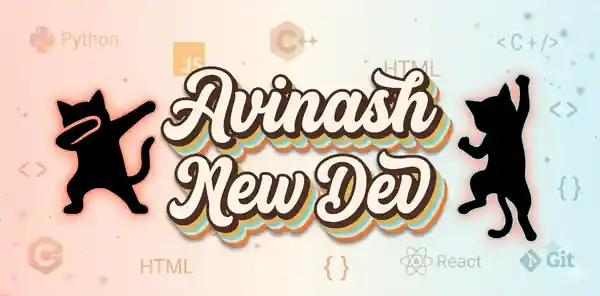

<!-- Profile banner -->

  

<h1 align="center">Hi, I'm Avinash Jadhav 👋</h1>
<h3 align="center">Independent Developer · Building useful tools, media experiences & web projects</h3>

  
  

---

## 👨‍💻 About Me

I'm Avinash, a developer who enjoys turning ideas into practical software. I work across web technologies and Python, with a strong interest in media players, IPTV tooling, search experiences, automation and polished user interfaces.

- 🔭 **Building:** Infinity Player, VLC-inspired web player experiences and developer tools
- 🌱 **Exploring:** Python, JavaScript, HTML, CSS and modern application development
- 🎯 **Interested in:** Media playback, web apps, UI/UX, search systems and automation
- 🧪 **Approach:** Build, test, improve and document — one feature at a time
- 🤝 **Open to:** Learning, feedback and collaboration on useful projects

## 🧰 Technologies & Tools

  
  
  
  
  
  
  

## 🚀 Featured Projects

| Project | What it does |
|---|---|
| [**Infinity Player**](https://github.com/avinashnewdev/Infinity-Player) | A cinematic browser-based audio/video player with local media, online playlists, queue controls and personalization |
| [**VLC New Theme HTML Player**](https://github.com/avinashnewdev/VLC-NEW-THEM-HTML-) | An independent browser media-player interface with playlist tools, video controls and PWA support |
| [**LIVE-TV-SERVER**](https://github.com/avinashnewdev/LIVE-TV-SERVER-) | Python/Flask project for serving M3U playlists through an Xtream Codes-compatible API |
| [**My Own Search Engine**](https://github.com/avinashnewdev/MY-OWN-SEARCH-ENGINE-USING-SCRAP) | A search-engine project exploring web scraping, indexing, ranking and a custom web interface |

  <a href="https://github.com/avinashnewdev?tab=repositories"><strong>Browse all public repositories →</strong></a>

## 📊 GitHub Snapshot

  
  

  

## 📫 Find Me on GitHub

  

<i>“Keep building. Keep learning. Make every version better than the last.”</i>

